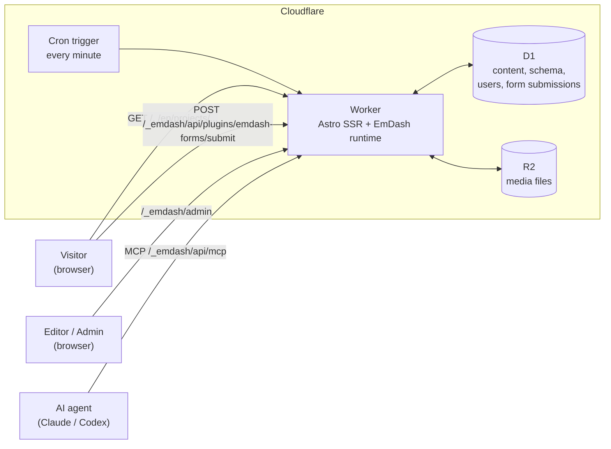
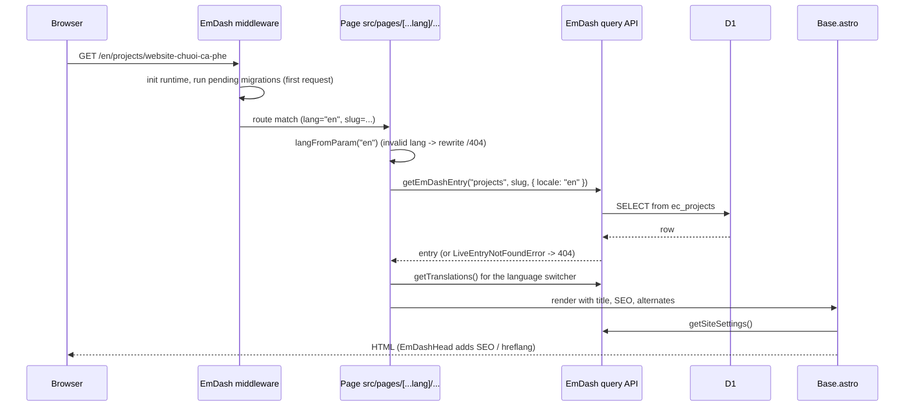
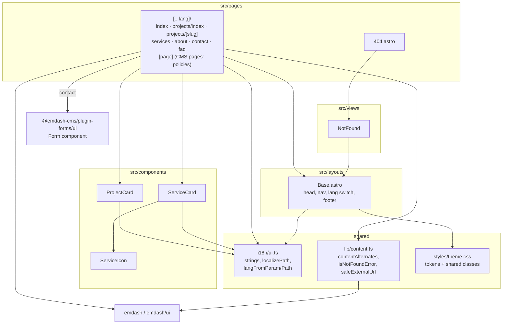
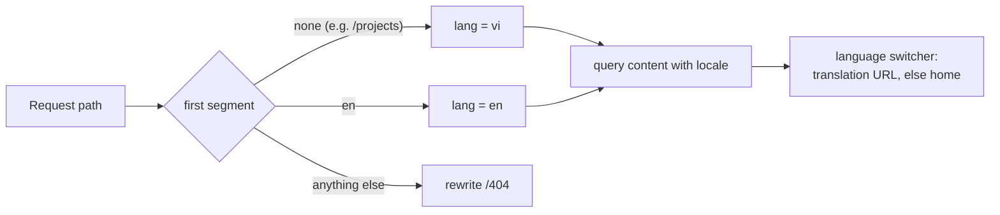
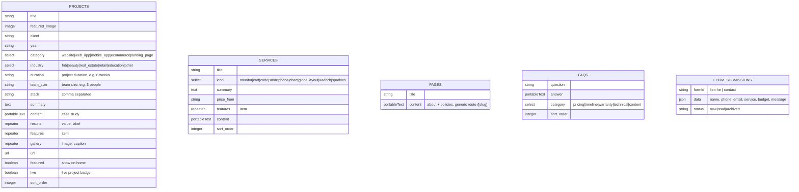
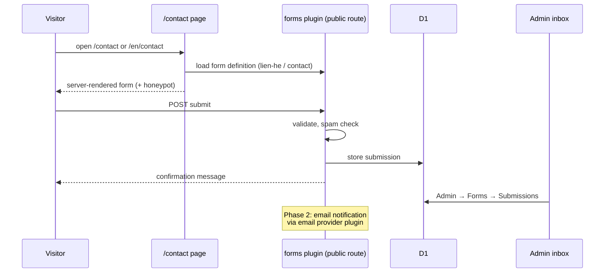

# Architecture

## Tech stack

| Layer          | Choice                                 | Notes                                                      |
| -------------- | -------------------------------------- | ---------------------------------------------------------- |
| Framework      | Astro 7 (`output: "server"`)           | Every page is server-rendered on each request              |
| CMS            | EmDash 0.40                            | Schema in the DB, admin UI at `/_emdash/admin`, MCP server |
| UI             | `.astro` components + plain CSS tokens | React is only used inside the EmDash admin                 |
| i18n           | Astro i18n (`vi` default, `en`)        | EmDash stores one row per locale, linked as translations   |
| Forms / leads  | `@emdash-cms/plugin-forms`             | Public submit route, submissions stored in D1, admin inbox |
| Runtime        | Cloudflare Workers                     | `@astrojs/cloudflare` adapter, entry `src/worker.ts`       |
| Database       | Cloudflare D1 (SQLite), binding `DB`   | Content, schema, users, plugin storage                     |
| Media          | Cloudflare R2, binding `MEDIA`         | Uploaded images                                            |
| Scheduled jobs | Workers cron (every minute)            | Scheduled publishing, plugin cron (form cleanup)           |
| Font           | Be Vietnam Pro (Astro Fonts API)       | Covers Vietnamese diacritics                               |
| Tooling        | TypeScript, `astro check`, Wrangler 4  |                                                            |

## System overview

## Request flow (public page)

## Code structure

## i18n routing

- Vietnamese has no prefix (`prefixDefaultLocale: false`); English is under `/en`.
- Slugs can be the same in both languages (for example, `about`).
- `hreflang`: static pages emit links from `Base.astro`. Content pages get them from `EmDashHead` once the site URL is set in Admin → Settings.

## SEO and discovery

`src/layouts/Base.astro` is the single public-page head. It passes the resolved
title, description, canonical URL, robots directive and absolute share image to
EmDash's `EmDashHead`, which renders the standard description, Open Graph,
Twitter Card, canonical and WebSite JSON-LD tags. The layout also emits the
site-wide Organization graph and a BreadcrumbList for project detail entries.
Static pages render Vietnamese, English and `x-default` alternates in the
layout; translated content entries get their alternates from EmDash's
translation-aware head integration.

The default share image is `public/og-default.png`. A project featured image
provided by its SEO/content data takes precedence. The public site origin is
read from EmDash Admin → Settings → Site URL, with the current request origin
as the local/development fallback, so changing the production domain requires
one settings change.

`src/pages/sitemap.xml.ts` provides the top-level sitemap. It includes the
Vietnamese and English home, projects, services, about, contact and FAQ routes,
all published project detail routes and the CMS pages served by the generic
`[page]` route (policies), and emits their hreflang pairs. Pairs assume the vi
and en entries share a slug. EmDash's
`robots.txt` endpoint allows public crawling, disallows `/_emdash/`, and links
to this sitemap. The 404 page is marked `noindex` and is excluded from the
sitemap.

## Content model

Every content row also has system fields: `id` (ULID), `slug`, `status`, `locale`, `translation_group`, timestamps. `vi` and `en` rows of the same item share a `translation_group`.

## Lead flow

## Environments

| Env        | Database                                    | How to run        |
| ---------- | ------------------------------------------- | ----------------- |
| Local      | Miniflare D1/R2 in `.wrangler/state`        | `pnpm dev`        |
| Production | Cloudflare D1 `ctstack`, R2 `ctstack-media` | `pnpm run deploy` |

Secret: `EMDASH_ENCRYPTION_KEY` (`.env` locally, `wrangler secret put` in production).
